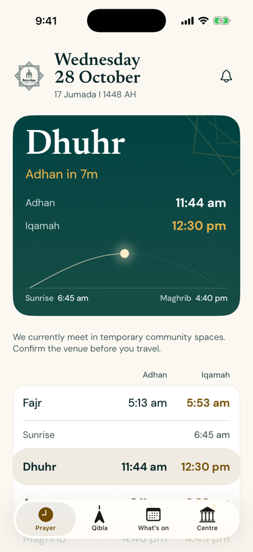
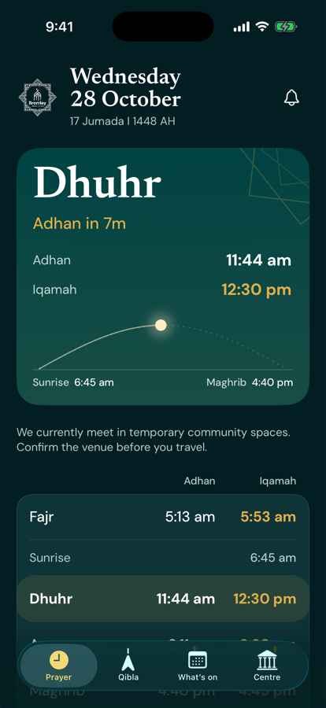
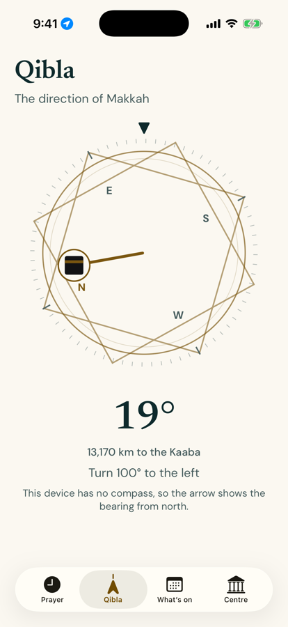
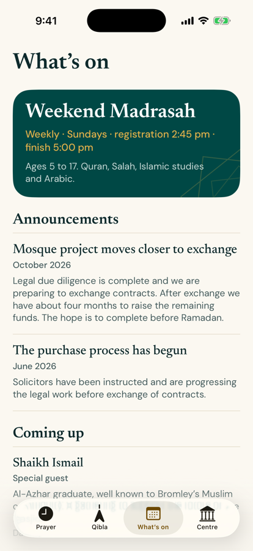
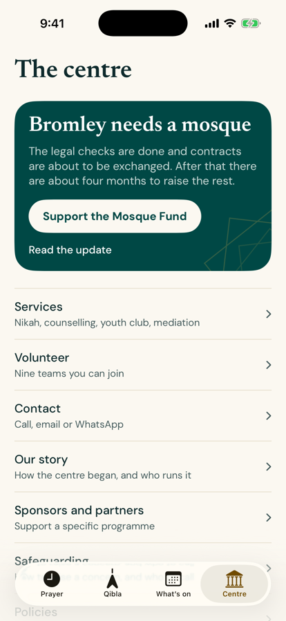
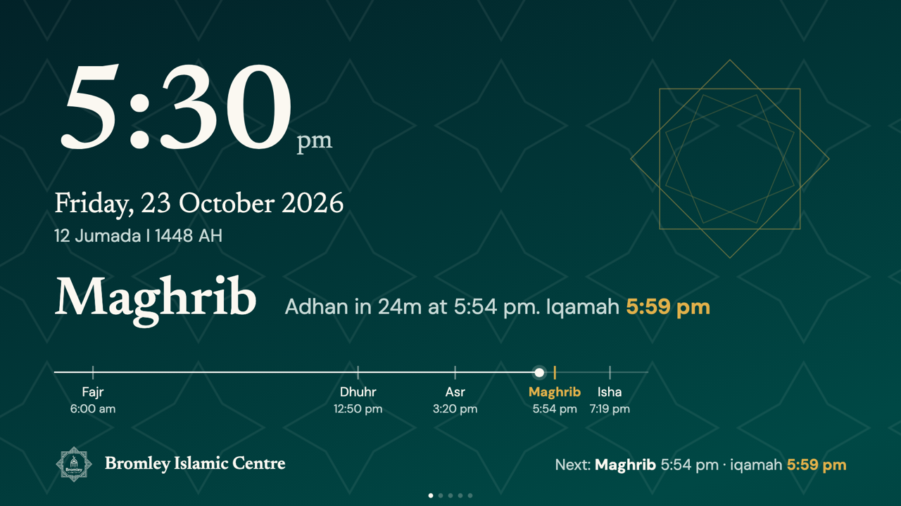
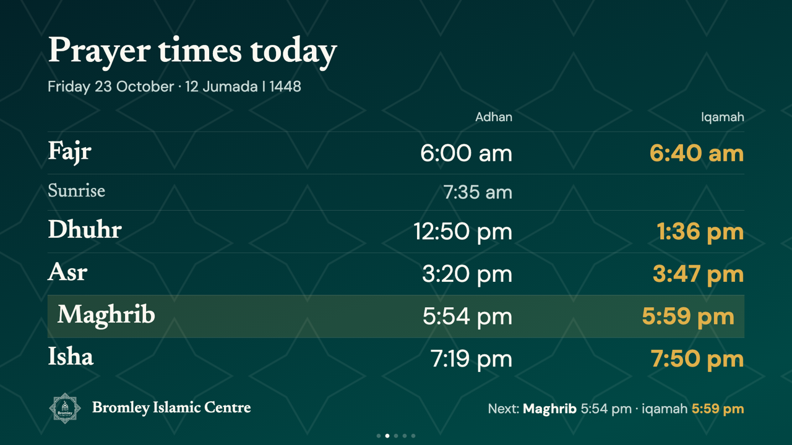

# Bromley Islamic Centre app

A native iOS app, committee editor and TV display for a real mosque in Bromley, UK. It shows prayer times, a Qibla compass, widgets and prayer alerts, and a small web page lets volunteers update the content without an App Store release.

Swift 5, SwiftUI, WidgetKit, iOS 18+, no third-party dependencies. The backend is a Node serverless API on Vercel.

<p>
  
  
  
  
  
</p>

## Why it exists

The mosque had a website but nothing a worshipper could keep on a phone. People check the same few things several times a day: when the next prayer is, when the congregation starts, which way to face, what is on this week. The app puts those in one place and works offline.

Content that changes (Friday prayer slots, announcements, events, Ramadan details) is edited by the committee from a phone-friendly page, so updates don't wait on me.

| Part | Folder | What it does |
|---|---|---|
| iOS app and widgets | `Sources/`, `Widgets/` | Prayer times, live countdown, Qibla, alerts, events, centre information |
| Committee editor and API | `admin/` | Passcode-protected web page and serverless endpoints on Vercel |
| TV display | `admin/public/tv/` | Full-screen rotating slides for the mosque's TV |

## What it does

- **Prayer tab.** Adhan and iqamah for all five prayers, a live countdown and the Hijri date. The header card draws the sky over Bromley, with the sun or moon on an arc and colours that move from dawn to dusk using that day's real times.
- **Qibla.** A compass dial that rotates with the phone, says how far to turn, and gives a haptic when you face Makkah. If location is denied it uses Bromley's coordinates, and it says so when a device has no compass.
- **Alerts.** Local notifications for adhan, a 10-minute iqamah reminder, and Ramadan imsak and iftar. There are no accounts and no push server.
- **Widgets.** Small, medium and large for the home screen, plus circular, rectangular and inline for the lock screen. The countdown ticks without waking the app.
- **Ramadan mode.** It detects Ramadan from the Umm al-Qura calendar, shows a day counter with imsak and iftar, and lets the committee override the start date after moon sighting.
- **What's on.** The app reads dates out of free text such as "Fri 23 Oct 2026 · 1:15 pm", counts down to the next event and hides events that have passed.
- **Accessibility.** Light and dark palettes with text pairs checked for 4.5:1 contrast, fonts that scale with Dynamic Type, and layouts checked at the largest accessibility size. Gold text is darker in light mode because the brand gold fails contrast on cream.
- **TV display.** Five slides: a clock with Hijri date and next-prayer countdown, today's timetable, a mosque message, events and Jumu'ah. The page is sized to a 16:9 box so odd screen shapes don't overflow, long text shrinks to fit, and times are cached in the browser so a restart with no internet still shows real times.

<p>
  
  
</p>

## How it fits together

```
London Unified Prayer Timetable
        |
        |  API key stays on the server
        v
   /api/times ------------------+
                                |
   Committee editor             +--> iOS app and widgets
        |                       |
        v                       +--> TV page
   /api/config  (Vercel Blob) --+
```

`PrayerSource` picks the official timetable when the app has it and falls back to an on-device astronomical calculation (`PrayerCalculator`). The committee's iqamah rules are applied on top. Everything is cached, so the app works offline.

## Engineering decisions

- **The API key never ships in the app.** The timetable provider needs a key, and a key inside an iOS binary can be extracted. The app calls `/api/times` on my Vercel project, which holds the key as an environment variable and caches responses at the CDN for a day. The committee passcode also lives only on the server. See `admin/api/times.js`.
- **The calculator is a real fallback.** `PrayerCalculator` computes times from the sun's position at Bromley's coordinates, with angles fitted against the centre's published times. It takes over when the timetable is missing or the phone is offline. `Tests/PrayerCalculatorTests.swift` sweeps every day of 2026 and 2027.
- **A clock-change bug, found on the day.** On 25 Oct 2026, when the clocks went back, Maghrib showed an hour early on the simulator. The calculation counted hours from London midnight, which is wrong on 23 and 25 hour days. It now anchors on UTC midnight, and a regression test covers all three clock-change dates.
- **Notifications under a hard OS limit.** iOS keeps only 64 pending local notifications. `AlertPlanner` (pure and unit-tested) fills those slots in time order, so reach depends on what is switched on: about 12 days for all five adhans, about two months for one prayer. A day before the alerts run out it schedules a "prayer alerts are about to pause" notification, and a background refresh task tops them up.
- **Widgets that can't share storage.** Without an App Group the widget can't read the app's data, so it compiles the same data and logic files, fetches its own copy of the timetable and quietly falls back to the calculator. Timeline entries sit at each adhan, each iqamah and iqamah plus 15 minutes.
- **A stale-read bug in the editor.** Testing the editor end to end, `GET /api/config` kept returning old content for minutes after a publish, because the CDN served the overwritten file stale to the function. Reads now use a cache-busting query string.
- **A known weak spot.** The editor's lockout counter is a read-modify-write on Blob storage, and testing showed it doesn't stop fast guessing. The fix is a long passphrase plus a platform rate limit. It's listed under limits below rather than hidden.
- **Design cleanup.** I went through every screen and removed repeated icon tiles, gold kicker labels above headings and identical cards, so hierarchy comes from type and spacing.

## Testing

- 77 unit tests in `Tests/` using Swift Testing. They cover prayer calculation across two years and the clock changes, next-prayer states, iqamah rules, alert planning, Ramadan dates, event date parsing, Qibla bearing, widget timelines, remote-config decoding and timetable sourcing.
- `cd admin && npm test` validates config input and timetable trimming.
- I checked layouts in the simulator in light, dark and the largest accessibility text size. The TV page was rendered at 1080p, 768p and 5:4, then checked on the real TV.

## Run it

You need Xcode 26, [XcodeGen](https://github.com/yonaskolb/XcodeGen) and an iOS 18 simulator.

```bash
xcodegen generate     # project.yml is the source of truth; the .xcodeproj is git-ignored
xcodebuild -project BromleyIslamicCentre.xcodeproj -scheme BromleyIslamicCentre \
  -destination 'platform=iOS Simulator,name=iPhone 17 Pro' -derivedDataPath build build
```

Swap `build` for `test` to run the tests. The app reads live content from my deployed editor, so it works without any setup. To use your own backend, deploy `admin/` to Vercel (see [admin/README.md](admin/README.md)) and change `PrayerFeed.baseURL`. With no timetable key the app uses its calculated times.

## Status and limits

- It was built for the mosque and reviewed with its committee. It runs on my own iPhone through SideStore. It isn't on the App Store, which needs a paid developer account and the centre's sign-off.
- The centre information (services, story, policies) mirrors the website as of October 2026 and will drift until it moves into the editor.
- Widgets leave out Jumu'ah times and committee content on purpose, since they would go stale.
- Not yet checked: VoiceOver on every screen, StandBy mode, and widgets on a physical device. Arabic and Urdu aren't built.

## Author

Hassan Amin · [GitHub](https://github.com/lolhazz) · <!-- add email, LinkedIn or portfolio -->

The Bromley Islamic Centre name, logo and website content belong to the centre.
